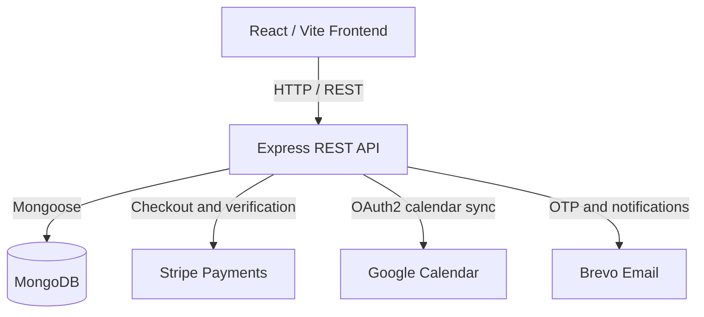

# BookMe

BookMe is a full-stack appointment booking and management platform that helps service providers manage their schedules, accept payments, and organize their businesses through a single, personalized booking page.

## Overview

BookMe simplifies appointment scheduling by bringing booking, payments, calendar synchronization, and business management together in one platform.

Designed for freelancers, consultants, coaches, clinics, and small businesses, it helps providers reduce manual coordination, avoid scheduling conflicts, and deliver a smoother booking experience for their clients.

## Key Features

- **Public Booking Pages:** Unique booking links where customers can explore services, choose available time slots, and book appointments.
- **Email OTP Verification:** Six-digit email verification codes for account registration and appointment bookings, delivered through Brevo.
- **Dynamic Availability:** Automatically generates time slots based on service duration, weekly working hours, and existing appointments to prevent overlapping bookings.
- **Google Calendar Integration:** Syncs appointments with Google Calendar, including event creation, rescheduling, and cancellation.
- **Online Payments:** Stripe Checkout integration for paid services, with temporary slot reservations during checkout.
- **Wallet and Payout Management:** Tracks provider earnings, platform fees, transaction history, and withdrawal requests. The platform allocates 90% of payments to providers and 10% as a platform fee.
- **Appointment Management:** Enables providers to manage, reschedule, and cancel appointments with automated email notifications.
- **Admin Dashboard:** Provides platform-wide analytics, user statistics, revenue tracking, and payout request management.
- **Custom Branding:** Allows providers to personalize their booking pages with business details, themes, and accent colors.

## Tech Stack

| Technology | Purpose |
|---|---|
| React 19, Vite | Frontend development and UI |
| Tailwind CSS v4 | Responsive styling |
| React Router v7 | Client-side routing |
| Node.js, Express | Backend REST API |
| MongoDB, Mongoose | Database and data modeling |
| Stripe API | Payment processing |
| Google Calendar API, OAuth2 | Calendar synchronization |
| Brevo | OTP and transactional emails |
| JWT, Bcrypt | Authentication and password security |

## Screenshots

### Public Booking Page


### Provider Dashboard


### Service Management


### Availability Scheduler


## Architecture

BookMe follows a client-server architecture with a React frontend, an Express backend, and integrations with external services.



- **Frontend:** React SPA with Axios-based API communication and token injection through interceptors.
- **Backend:** Express REST API organized into controllers, routes, middleware, models, and utility modules.
- **Database:** MongoDB stores users, services, availability, bookings, and wallet transactions.
- **External integrations:** Stripe handles payments, Google Calendar synchronizes appointments, and Brevo delivers verification codes and notifications.

## Project Structure

```text
bookme/
├── backend/
│   ├── config/        # Database configuration
│   ├── controllers/   # Request handlers
│   ├── middleware/    # Authentication and authorization
│   ├── models/        # Mongoose schemas
│   ├── routes/        # API route definitions
│   ├── utils/         # Payment, email, calendar, and scheduling helpers
│   ├── .env.example
│   ├── package.json
│   └── server.js
├── frontend/
│   ├── public/
│   ├── src/
│   │   ├── admin/
│   │   ├── api/
│   │   ├── assets/
│   │   ├── components/
│   │   ├── context/
│   │   ├── pages/
│   │   ├── App.jsx
│   │   ├── index.css
│   │   └── main.jsx
│   ├── package.json
│   └── vite.config.js
└── README.md
```

## Getting Started

### Prerequisites

- Node.js 20 or later
- npm 9 or later
- MongoDB local instance or Atlas cluster
- Stripe account with test API keys
- Google Cloud project with Google Calendar API enabled
- Brevo account with a verified sender and API key

### 1. Clone the Repository

```bash
git clone https://github.com/your-username/bookme.git
cd bookme
```

### 2. Install Dependencies

```bash
cd backend
npm install

cd ../frontend
npm install
```

### 3. Configure Environment Variables

Create the backend environment file:

```bash
cp backend/.env.example backend/.env
```

Add your configuration to `backend/.env`:

```env
PORT=5001
CLIENT_URL=http://localhost:5173

# Database
MONGODB_URI=mongodb+srv://<username>:<password>@cluster0.mongodb.net/bookme

# Authentication
JWT_SECRET=your_secret_key

# Google Calendar
GOOGLE_CLIENT_ID=your_client_id
GOOGLE_CLIENT_SECRET=your_client_secret
GOOGLE_REDIRECT_URI=http://localhost:5001/api/integrations/google/callback

# Brevo Email
BREVO_API_KEY=your_brevo_api_key
BREVO_SENDER_EMAIL=your_verified_email@example.com
BREVO_SENDER_NAME=BookMe
EMAIL_FROM=your_verified_email@example.com

# Stripe
STRIPE_SECRET_KEY=sk_test_your_stripe_secret_key

# Admin
ADMIN_EMAIL=admin@bookme.com
ADMIN_PASSWORD=your_admin_password
```

For a custom backend URL, optionally create `frontend/.env`:

```env
VITE_API_URL=http://localhost:5001/api
```

### 4. Start the Backend

```bash
cd backend
npm start
```

The API runs at `http://localhost:5001`.

### 5. Start the Frontend

In a separate terminal:

```bash
cd frontend
npm run dev
```

The frontend runs at `http://localhost:5173`.

## How to Use

### Provider Setup

1. Open the application and register an account.
2. Verify your email using the six-digit OTP.
3. Configure your business name, timezone, and booking URL.
4. Connect Google Calendar if calendar synchronization is needed.

### Configure Services and Availability

1. Create services with names, durations, prices, and descriptions.
2. Configure weekly working hours and available time windows.
3. Share your personalized booking link with customers.

### Customer Booking

1. Customers open the provider's booking page.
2. They select a service and an available time slot.
3. They enter their contact information and verify their email.
4. They complete Stripe Checkout if the service requires payment.
5. The booking is confirmed and synchronized with Google Calendar when connected.

### Manage Appointments and Earnings

Providers can view and filter appointments, reschedule or cancel sessions, track earnings, configure payout details, and request withdrawals from the dashboard.

### Admin Dashboard

Administrators can sign in at `/admin/login` to view platform metrics and manage provider withdrawal requests.

## API Overview

| Endpoint | Description |
|---|---|
| `/api/auth` | Registration, OTP verification, login, profile |
| `/api/services` | Create, update, list, and deactivate services |
| `/api/availability` | Manage weekly availability |
| `/api/bookings` | View, update, reschedule, and cancel bookings |
| `/api/public` | Public profiles, available slots, OTP, and customer bookings |
| `/api/payments` | Wallet, transactions, payout details, withdrawals |
| `/api/admin` | Admin authentication, analytics, and withdrawal management |

## Testing

Run the frontend lint checks:

```bash
cd frontend
npm run lint
```

Build the frontend for production:

```bash
npm run build
```

Check backend entry-point syntax:

```bash
node --check backend/server.js
```

For an end-to-end check, register a test provider, configure a service and availability, complete a customer booking, and verify the resulting payment, email, and calendar event.

## Limitations and Future Improvements

**Current limitations**
- Full functionality requires configured third-party credentials.
- Payments currently use INR.

**Planned improvements**
- Stripe webhook handling for asynchronous payment events.
- SMS and WhatsApp appointment reminders.
- Multi-provider organization accounts.
- Customer self-service cancellation and rescheduling through secure email links.

## License

This project is licensed under the [ISC License](backend/package.json).

---
Made with passion by **Vandit Vijay**. For questions, feedback, or support, please contact [vijayvandit101@gmail.com](mailto:vijayvandit101@gmail.com).
